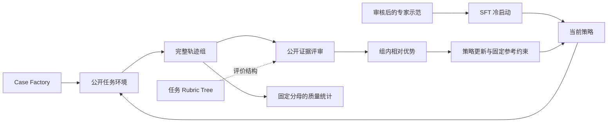
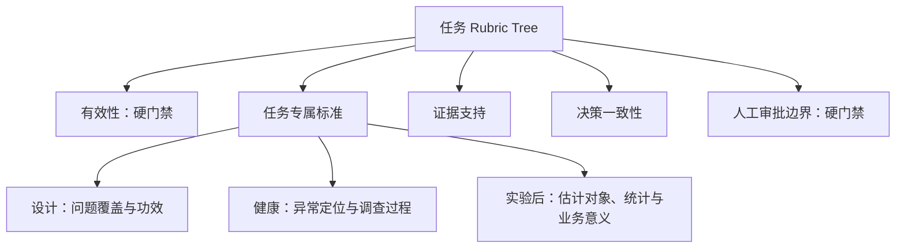

<div align="center">

# CAUSALQUEST

**面向证据驱动因果任务的 SFT 与 Agentic RL 训练框架**

让模型在环境中自主调查、调用工具、核对证据，并作出有依据的实验决策。

[](https://docs.python.org/3/)
[](https://pytorch.org/)
[](https://huggingface.co/docs/transformers/index)
[](https://huggingface.co/docs/peft/index)
[](docs/VALIDATION.md)
[](LICENSE)

[框架特色](#框架特色) · [Rubric Tree](#rubric-tree把任务要求变成可检查的评价结构) · [快速开始](#快速开始) · [验收结果](#已完成的验证) · [架构说明](docs/ARCHITECTURE.md)

</div>

CAUSALQUEST 将**任务环境、监督微调、自主轨迹采样、证据评审与强化学习更新**连接起来，
为因果分析 Agent 提供可复现的训练与评测闭环。模型从任务初始状态出发，自行获取信息、
维护调查状态、处理工具反馈，最终提交包含证据和行动建议的报告。

当前版本为 **v0.1.0a1，研究型 Alpha 版本**。单张 A40 上已经完成真实 Qwen3-4B 的
SFT → 自主采样 → 人工评审 → RL 更新 → 保存与独立重载验证。框架运行验收与任务效果分别报告，
便于研究者判断一个改动究竟改善了训练流程，还是提升了模型能力。

## 为什么面向因果任务？

在实验决策中，“算出一个正向效果”只是调查的一部分。模型还要判断指标定义是否一致、
来源是否可靠、比较对象是否正确，以及置信区间与业务门槛究竟支持哪种行动。

例如，实验结果的区间下界超过 0，却没有超过预先登记的 MDE，支持的建议就可能与
“已经证实达到业务收益门槛”不同。如果日志存在缺失，模型还需要先处理数据有效性，
再决定是否解释效果。我们希望训练的是贯通 **对象 → 证据 → 关系 → 行动** 的能力。

框架内置三类任务，覆盖实验生命周期中的不同决策：

| 任务 | Agent 需要完成什么 |
|---|---|
| **实验设计评审** | 检查指标、随机化、护栏和样本量，定位设计缺口，提出可执行的修订 |
| **实验健康诊断** | 调查运行状态、观测完整性及切片异常，判断继续、暂停或补充调查 |
| **实验后决策** | 核对来源与比较对象，结合效果、区间、多重比较和 MDE，提出选择、拒绝或重跑建议 |

Case Factory 构造受控案例及其工具环境。数据库、文档、工具观测与评测参考各有明确用途；
模型能看到的是任务公开提供的信息，需要通过调用工具逐步收集证据。

## 框架特色

| 组成部分 | 解决的问题 |
|---|---|
| **SFT 与 RL 共用任务环境** | 专家示范与模型采样沿用领域工具、调查状态和报告接口，减少训练与执行脱节 |
| **按任务组织的 Rubric Tree** | 将有效性、统计判断、证据与决策要求整理成带版本、权重和硬门禁的评价结构 |
| **七维公开证据评审** | 分开检查结论、证据、关系和行动，避免只凭报告格式或一个总分判断质量 |
| **完整轨迹分组训练** | 在同一任务下采样多条完整轨迹，导入评审，再进行组内比较与策略更新 |
| **可核对的训练与采样记录** | 保存原生 token、实际采样参数、行为概率与旧策略分数，检查更新前的概率一致性 |
| **明确的阶段与恢复机制** | 评分绑定原始轨迹，失败保留分母；检查点包含优化器、随机状态和训练进度，并验证独立重载 |



Rubric Tree 描述任务评价结构；当前 RL 使用下文的七维评审接口产生排序。
两者的具体实现与对应关系见 [Rubric Tree 说明](docs/RUBRIC_TREE.md)。

## 程序负责计算，Agent 负责调查与决策

模型自主决定调用什么工具、检查哪个对象、输入哪些操作数、引用什么证据、如何更新调查状态，
以及最终建议采取什么行动。环境负责执行请求、返回观测并记录历史。

除文档查询、实验查询、功效估计、统计分析等领域能力外，框架统一接入五个数值辅助工具：

| 工具 | 用途 |
|---|---|
| `calculate` | 对模型提供的数值执行算术运算 |
| `calculate_change` | 计算基线与当前数值之间的变化 |
| `convert_rate` | 转换比例、百分比等支持的数值单位 |
| `compare_numbers` | 明确两个数值的大小关系 |
| `compare_interval` | 比较区间与指定阈值的关系 |

辅助工具与证据工具共用调用预算。例如，程序可以返回区间和 MDE 的比较结果；
模型仍要选对指标、对象、单位和门槛，并把结果落实为合理行动。
工具不会替模型选业务决策，也不会在自主采样时注入专家行动路径。

## Rubric Tree：把任务要求变成可检查的评价结构

因果任务通常同时包含前提、证据和行动约束。Rubric Tree 将这些要求组织为有名称和版本的节点，
每个节点包含 **ID、说明、局部权重、硬门禁标记**，同级节点的权重之和为 1。



上图按含义归类展示。实际三棵树目前均为“根节点 + 一层任务标准”；数据结构支持继续嵌套。
可直接查看 [设计评审](examples/rubrics/design_review.json)、
[健康诊断](examples/rubrics/health_diagnosis.json)、[实验后决策](examples/rubrics/post_experiment.json)
的完整 JSON，或通过 Python 导出：

```python
from causalquest.evaluation.post_experiment import build_post_experiment_rubric, rubric_to_dict

tree = build_post_experiment_rubric()
print(tree.version)
print(rubric_to_dict(tree))
```

这样的结构让任务要求、权重和前提清晰可查，也便于按错误类型分析模型。
当前版本中，历史确定性验证器保留自己的检查项聚合规则；RL 则使用独立的七维语义评审。
**树节点权重尚未自动转换为 RL 奖励或局部过程奖励。**

## 从七维评审到强化学习

评审只依据模型实际获得的公开证据，适用维度采用 0–2 分：

| 维度 | 主要检查什么 |
|---|---|
| 有效性 `validity` | 来源、指标、单位、总体和分析前提是否正确 |
| 效应估计 `effect` | 效果、区间、比较对象及统计解释是否正确 |
| 异常诊断 `diagnosis` | 异常判断和定位是否与观测一致 |
| 证据覆盖 `evidence` | 关键论断是否由先前实际获得的证据支持 |
| 决策一致性 `decision` | 结论、已接受状态与后续行动是否相互一致 |
| 不确定性校准 `uncertainty` | 是否正确区分未知、统计不确定性与业务门槛 |
| 格式 `format` | 是否满足状态更新和最终报告的结构要求 |

不适用的维度保留为 `null`。评审结果按协议归入四个等级：终局未提交或硬违规为 0 级，
核心结论不受支持为 1 级，核心受支持但仍有缺陷为 2 级，适用要求完整满足为 3 级。
同等级内部继续做语义维度的 Pareto 比较，格式只在语义打平时参与比较。

训练采用 **GRPO 族的序数分组相对目标**：用组内胜负关系构造优势，再进行带裁剪的策略更新。
具体实现有以下特点：

- 当前策略与冻结旧策略构成更新比率；固定 SFT 参考模型提供约束。
- 没有核心正确轨迹的组保持零直接策略优势，继续参与参考约束和批次统计。
- 每条轨迹占相同批次权重，目标 token 在完整轨迹内部取平均。
- 分别记录实际采样分布与原始 HF 概率；旧策略相对行为分布的条件 token 修正权重上限为 2。

该修正采用近似目标；原始 GRPO 的奖励 z-score、自动语义裁判和过程信用分配均未作为本版默认实现。
完整评分规则见 [评审协议](docs/REVIEW_PROTOCOL.md)。

## 快速开始

```bash
git clone https://github.com/Arrebol612/CAUSALQUEST.git
cd CAUSALQUEST
python -m venv .venv
# Linux/macOS: source .venv/bin/activate
# PowerShell: .venv\Scripts\Activate.ps1
python -m pip install -e '.[train,dev]'
cq doctor
cq demo --output outputs/demo
```

CPU Demo 使用一个可学习的小型 toy 策略，执行真实 Torch 更新，跑通 SFT、分组采样、示例评分、
RL、保存重载与评测。结果带有 `test_fixture_only: true`，用于检查闭环。
若希望停在人工评审入口，可运行 `cq demo --output outputs/manual_demo --manual`。

无需模型或 API 即可构建领域教程：

```bash
python scripts/prepare_domain_tutorial.py --output local_data/domain_tutorial
cq data check --input local_data/domain_tutorial/train_steps.jsonl
```

教程生成三个自行编写的合成 TRAIN 案例，并回放 13 个动作，覆盖证据获取和一段设计修订。
它不依赖原研究目录或私有数据，也没有提供三类任务的全部专家解法。

## 使用本地模型训练

复制 [HF 配置示例](configs/hf_local.example.json)，填写本地模型、审核后的训练数据和案例目录。
路径相对配置文件解析；模型权重单独准备。教程可使用生成的 `case_catalog.json` 与 `train_steps.jsonl`。

```bash
cq train sft --config configs/my_sft.json --output outputs/sft
# 将采样配置的 adapter 指向保存后的 outputs/sft/model。
cq sample --config configs/my_sampling.json --split train --output outputs/round1
# 阅读 review_packet.json，编辑 review_template.json 的副本。
cq reviews check --run outputs/round1 --input local_reviews/round1.json
cq reviews import --run outputs/round1 --input local_reviews/round1.json
cq evaluate --run outputs/round1
# 更新配置保持本轮采样策略，并指定固定 SFT reference。
cq train rl --config configs/my_update.json --run outputs/round1 --output outputs/rl1
```

下一轮用 `outputs/rl1/model` 重新采样。每次 RL 命令最多更新一次完整已评审批次。
后续 RL 轮次恢复前一轮优化器；SFT 转 RL 时新建优化器。SFT 支持常数学习率、有步数上限的顺序遍历，
并恢复数据游标及优化器状态。命令要求新的输出目录，避免覆盖已有结果。

生成与评分共用模型快照和 tokenizer。框架保存实际温度、top-p、top-k、原生 prompt/completion token，
以及独立的行为与旧策略分数。检查点包含优化器、随机状态和进度，保存后重新加载核验模型身份。
数据格式与接口约定见 [架构说明](docs/ARCHITECTURE.md)。

## 已完成的验证

| 验证内容 | 结果 |
|---|---|
| 公共包 CPU 测试 | 38 项通过，覆盖训练闭环、真实梯度、恢复、领域工具边界与 Rubric Tree |
| 独立 wheel 安装检查 | 隔离导入，完成 toy SFT → 评审 → RL → 重载 |
| 真实模型与硬件 | Qwen3-4B，既有 recovery-SFT R60 适配器，单张 NVIDIA A40 |
| 真实 SFT | 1 次更新，梯度检查点实际执行，独立重载一致 |
| 真实自主采样 | 3 个合成 TRAIN 案例 × 2 个种子，共 6 条轨迹、91 次响应 |
| 真实评审与 RL | 全部 6 条进入评审和更新，1 个有核心支持的优势组，1 次优化器更新 |
| 更新前旧/当前 HF 概率最大差 | 0.0 |
| 峰值分配显存 | SFT 约 15.8 GiB；RL 约 23.5 GiB |
| 更新后的检查点 | 参数改变，独立重载一致，固定参考身份保持一致 |

最后一批采样在 RL 更新前有 **2/6 提交报告、1/6 核心结论受支持、0/6 严格完整成功**。
尚未完成独立的更新后任务质量对照。上述小规模验收验证执行闭环，训练收益需要在独立、同协议评测中衡量。

前期研究在原开发协议上观察到 SFT 改善，后续 RL 与辅助监督也出现收益不足或退化。
这些实验的任务面板、输入与报告协议不同，不合并为一条效果曲线。
详细统计见 [验收说明](docs/VALIDATION.md) 和 [机器可读结果](docs/acceptance_v0.1.json)。

## 目录与扩展范围

```text
src/causalquest/
  data/ tasks/ tools/ schemas/    数据构造、领域工具与结构约定
  evaluation/                    任务 Rubric Tree 与历史验证器
  framework/                     模型接口、SFT、采样、评审、RL 与运行产物
configs/                         可移植配置示例
examples/rubrics/                 三类任务评价树
scripts/prepare_domain_tutorial.py
tests/                          CPU 闭环、数学与边界测试
docs/                           架构、评审协议与验收说明
```

当前 sandbox 是应用层的受控任务环境，数据库工具只读；第三方不可信扩展应另行使用进程隔离。
首版使用 JSON 指标记录和人工语义评审。分布式训练、vLLM 训练采样适配、统一 TensorBoard 导出、
API 自动裁判与 OPD 训练器留待后续按研究需要扩展。

## 许可与数据

代码采用 [MIT 许可](LICENSE)。第三方模型、数据保留各自许可。
公开教程使用自行编写的合成数据；原始研究数据、模型权重、私有测试案例、服务器路径和凭据不进入公开源码包。

```bash
python scripts/build_release.py --output dist/CAUSALQUEST-v0.1.0a1-source.zip
```

发布脚本按白名单选择源码和文档，并检查明显凭据与个人路径。
新增数据与评价器时，请遵守 [数据和评测边界](docs/ARCHITECTURE.md#data-and-evaluation-boundaries)，
明确区分程序统计结果、业务政策、专家示范和语义评审标签的来源与适用范围。
