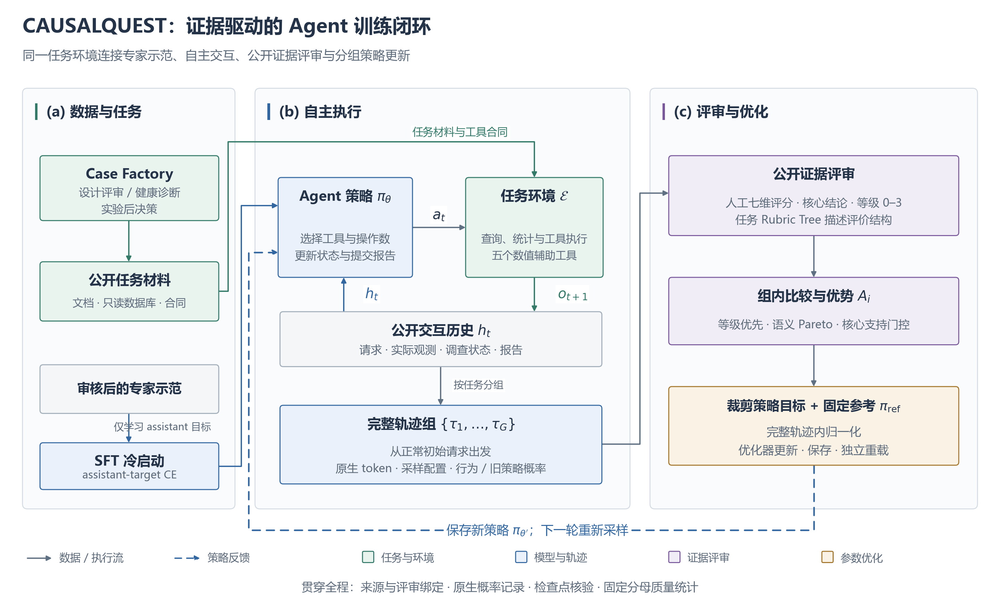
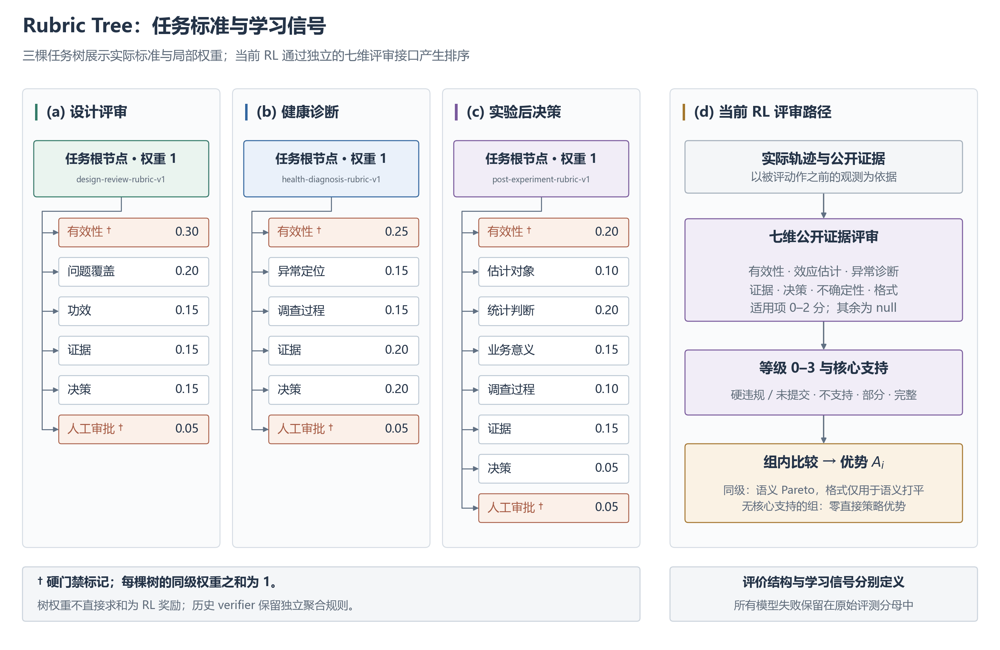

# 框架图与 Rubric Tree 图

两张图采用论文架构图常见的分面、模块分区、统一符号及克制配色。图中结构按当前代码组织，
图片为本项目原创绘制。布局参考 [HybridFlow 论文的分面与数据流表达](https://i.cs.hku.hk/~cwu/papers/gmsheng-eurosys25.pdf)
和 [Agent Lightning 的训练与执行架构图](https://www.microsoft.com/en-us/research/blog/agent-lightning-adding-reinforcement-learning-to-ai-agents-without-code-rewrites/?lang=ja)。

## 图 1：证据驱动的 Agent 训练闭环

[](figures/framework_architecture.svg)

- **(a) 数据与任务：** factory 提供案例与公开任务材料，审核后的示范用于 SFT 冷启动。
- **(b) 自主执行：** 策略根据可见历史选择动作；环境执行工具并返回观测；同一案例下形成完整轨迹组。
- **(c) 评审与优化：** 人工公开证据评审产生七维结果，经过等级、组内比较与核心支持门控得到优势，
  再执行带固定参考约束的策略更新。

实线表示数据或执行依赖，蓝色虚线表示新策略进入下一轮采样。$a_t$ 为动作，$o_{t+1}$ 为返回观测，
$h_t$ 为模型可见的交互历史。各节点表示逻辑阶段，不暗示训练、环境或评审已实现并行调度。

## 图 2：任务评价树与 RL 评审路径

[](figures/rubric_tree_and_reward.svg)

前三个面板完整展示三类任务各自的一层标准、实际权重和硬门禁标记。
权重与版本由生成脚本直接读取 `examples/rubrics/*.json`，避免图文与实现漂移。
第四个面板独立展示当前 RL 的人工七维评审、四等级与组内优势接口。

两类结构分别定义；树的局部权重未自动求和为当前 RL 奖励，也未自动分配到中间动作。
完整任务要求见 [Rubric Tree 说明](RUBRIC_TREE.md)。

## 文件与重新生成

| 图片 | GitHub 展示 | 矢量原图 |
|---|---|---|
| 训练架构 | [PNG](figures/framework_architecture.png) | [SVG](figures/framework_architecture.svg) |
| Rubric Tree 与评分路径 | [PNG](figures/rubric_tree_and_reward.png) | [SVG](figures/rubric_tree_and_reward.svg) |

```bash
python -m pip install -e '.[figures]'
python scripts/draw_framework_figures.py
```

重新生成时需要本地中文字体，例如 Noto Sans CJK SC 或 Microsoft YaHei；也可用 `--font` 指定字体文件。
字体文件不随仓库分发。SVG 将字形转为矢量轮廓，读者无需安装同款字体；PNG 为 180 dpi 导出。
渲染脚本检查文字是否超出画布，最终布局另经人工目视核对。
